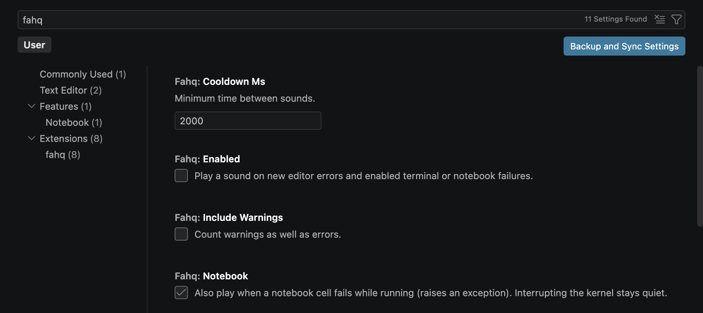

# Fahq

An error sound for VS Code and Cursor. It plays when you add an error to the file you're editing, a terminal command fails, or a notebook cell raises an exception.

## Install

1. Download the `fahq-*.vsix` from the [latest release](https://github.com/Yahlawat/fahq/releases/latest).
2. Open **Extensions → … → Install from VSIX…** in VS Code or Cursor and select the file. The same download works on macOS and Windows.
3. Click **fahq** in the status bar to turn it on. Use **Fahq: Play Sound** in the Command Palette to try the tone.

In Cursor, open the **Editor Window** before installing or using the extension.

Use **Fahq: Choose Sound File…** to pick a local clip or **Fahq: Use Default Sound** to go back to the bundled tone.

## When it plays

- **Editor.** Fahq waits for diagnostics to settle after a recent edit. It plays when the error count goes up in the active file. Opening a file with existing errors and fixing errors stay quiet.
- **Terminal.** A nonzero exit code can play a sound. Ctrl+C stays quiet. This needs the editor's terminal shell integration and a trusted workspace. Turn it off with `fahq.terminal`.
- **Notebooks.** A failed cell can play a sound. Keyboard interrupts stay quiet. Turn it off with `fahq.notebook`.

The default cooldown is two seconds across all three triggers. Open Settings and search for `fahq` to change the cooldown, the diagnostic delay, or whether warnings count. Volume control uses `afplay` on macOS. Windows uses system playback and volume.

### Standalone zsh on macOS

To use Fahq outside the editor, clone this repo to a permanent location and add `source "/path/to/fahq/shell/fahq.zsh"` to your `~/.zshrc`. Open a new terminal, then use `fahq off`, `fahq on`, or `fahq test`. The shell hook has its own mute state and cooldown.

## Develop

With Node.js 22 installed, run `npm ci`, `npm test`, and `npm run package`. The extension has no npm runtime dependencies. Run `npm run test:install` after packaging to check installation and activation in an isolated VS Code. On macOS, `bash test/run.sh` exercises the editor, notebook, and terminal triggers at zero volume, and `bash test/shell.sh` checks the standalone hook.

Released under the [MIT License](LICENSE). The bundled WAV is an original synthesized tone.
